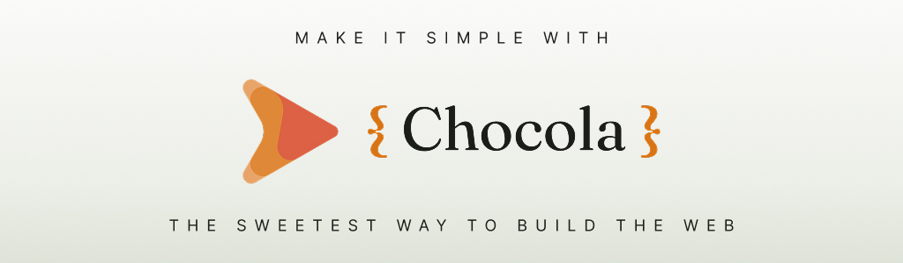

<picture>
    <source media="(prefers-color-scheme: dark)" srcset="assets/banner_dark.jpg">
    
</picture>

## What is Chocola

Chocola is a new and sweeter way to build your web apps.

Components are single `.chjs` files with `<template>`, `<script>`, and `<style>` sections. Chocola compiles them into a plain HTML fragment with scoped CSS and optional ESM runtime chunks. No framework runtime is required in the browser.

Components are used by importing them. The compiler discovers only the modules reachable from your root `.chjs` entry.

```html
<!-- file: Greeting.chjs -->
<script>
    export let name = "World";
</script>

<template>
    <h1>Hello {name}!</h1>
</template>

<style>
    h1 { color: chocolate; }
</style>
```

```html
<!-- file: app.chjs -->
<script>
    import Greeting from "./Greeting.chjs";
</script>

<template>
    <main>
        <Greeting name="Ada" />
    </main>
</template>
```

## Using the compiler

Chocola is the core library. A host such as [ChocolaKit](https://github.com/chocolajs/kit) owns the dev server, routing, document assembly, asset bundling, and output writing.

```js
import { buildModuleGraph, render } from "chocola/compiler";

const graph = await buildModuleGraph(process.cwd(), { entry: "app.chjs" });
const { html, styles, runtime, hashMap } = await render(graph, { name: "Ada" });
```

`render()` performs no project I/O. It returns:

- `html` — the root component fragment;
- `styles` — scoped CSS, ready for a host to serve or inline;
- `runtime` — `{ name, content }` ESM chunks for client-side hydration and `ChocolaComponent` classes;
- `hashMap` — root-relative module ids mapped to their CSS hashes.

The host writes files, assembles the document, and serves those assets.

## Supporting Chocola

As of now, Chocola is a project driven by one developer (me, [@sadgabi20](https://github.com/sadgabi20)), but made to be community driven in the future. Therefore, the only current way to support Chocola is via my [GitHub Sponsors](https://github.com/sponsors/sadgabi20).

If this project achieves a wider support, it will have its own official support channels.

## Documentation

- [Overview](documentation/01-introduction/01-overview.md)
- [Getting started](documentation/01-introduction/02-getting-started.md)
- [Fundamentals](documentation/02-components/01-fundamentals.md)

## Roadmap

If you want to know what is being worked on right now, see the [Roadmap](ROADMAP.md).

## Contributing

Please follow the [Contribution Guidelines](CONTRIBUTING.md) to know how to contribute to Chocola.

## License

[MIT](LICENSE)
